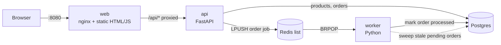
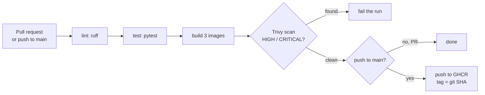

# shopflow-platform

A small online shop (3 services, Postgres, Redis) that I run the way a production
team would: containers, CI, Kubernetes, GitOps, monitoring, safe deploys, chaos
tests and security checks. The app is simple on purpose. The platform around it
is the project. Every phase below is a working, demoable step.

## Architecture (Phase 1: local run)



Order flow: the api saves the order as `pending` and pushes a job to Redis. The
worker takes the job and marks the order `processed`. If Redis is down, the api
still accepts the order, and the worker's sweep processes it later from Postgres.

## Tech stack

| Tool | Version | Why I chose this |
|---|---|---|
| FastAPI | 0.162.4 | Small, typed, validates input for me, auto-generates API docs at `/docs`. |
| Postgres | 17.11 | The default relational database; orders need transactions and row locks. |
| Redis | 7.4.12 | A Redis list is the simplest working job queue. No broker to operate. |
| nginx (unprivileged) | 1.31.7 | Serves static files and proxies `/api`, running as non-root. |
| Docker Compose | v5.4.0 | One command starts the whole stack locally with health-ordered startup. |
| pytest + ruff | 9.2.0 / 0.17.4 | Standard Python test runner; ruff is one fast tool for lint and import order. |
| prometheus-client | 0.26.0 | Exposes `/metrics` now, so Phase 5 only has to scrape. |
| GitHub Actions | actions pinned by SHA | CI lives next to the code, free for public repos, native GHCR login. |
| Trivy | 0.76.2 | One open-source scanner for OS packages and Python packages; easy to run locally too. |
| GHCR | - | Registry in the same place as the repo; the built-in `GITHUB_TOKEN` can push, no stored secret. |
| Dependabot | - | Exact pins go stale; it opens PRs for new versions and CI tests them. |

## Quickstart

Needs Docker Desktop running. PowerShell:

```powershell
.\tasks.ps1 up      # build, start, wait until every container is healthy
```

Open http://localhost:8080 (shop) or http://localhost:8000/docs (API docs).

| Task | What it does |
|---|---|
| `.\tasks.ps1 up` | Build and start the stack |
| `.\tasks.ps1 test` | ruff + pytest for api and worker, inside containers |
| `.\tasks.ps1 scan` | Trivy scan of the three images, same gate as CI |
| `.\tasks.ps1 smoke` | Place one order through nginx, check the worker processes it |
| `.\tasks.ps1 logs` | Follow all logs |
| `.\tasks.ps1 down` | Stop (keeps database data) |
| `.\tasks.ps1 clean` | Stop and delete database data |

## Endpoints

| Service | URL | Purpose |
|---|---|---|
| web | http://localhost:8080 | Shop UI |
| api | http://localhost:8000/healthz | Liveness: process is up |
| api | http://localhost:8000/readyz | Readiness: Postgres and Redis reachable |
| api | http://localhost:8000/metrics | Prometheus metrics |
| worker | http://localhost:9100/metrics | Prometheus metrics (queue depth, processed orders) |

## CI pipeline (Phase 2)



Workflow: [.github/workflows/ci.yml](.github/workflows/ci.yml). Images are tagged with the
full git SHA, never `latest`, so every running container maps to exactly one commit.

## Demo

<!-- TODO: record GIFs -->
- `docs/img/phase1-order-flow.gif` (placeholder): place an order, status goes pending -> processed.
- `docs/img/phase1-redis-down.gif` (placeholder): stop Redis, order still accepted, sweep recovers it.

## Phases

- [x] 1. Local run (Docker Compose)
- [x] 2. CI (GitHub Actions, Trivy, GHCR) - verified locally; first run on GitHub pending first push
- [ ] 3. Kubernetes (kind, Helm, ingress)
- [ ] 4. GitOps CD (ArgoCD)
- [ ] 5. Observability (Prometheus, Grafana, Loki, alerts)
- [ ] 6. Safe deployments (Argo Rollouts canary, k6)
- [ ] 7. Scaling and resilience (HPA, PDB, Chaos Mesh)
- [ ] 8. Security (Semgrep, SBOM, Cosign, Kyverno, NetworkPolicies)
- [ ] 9. Terraform on AWS (optional)

## Docs

- [docs/decisions/](docs/decisions/) - why each big choice was made (ADRs)
- [docs/lessons-learned.md](docs/lessons-learned.md) - real problems hit in each phase, the cause, and the fix
- [docs/runbooks/](docs/runbooks/) - how to debug each alert (starts in Phase 5)
